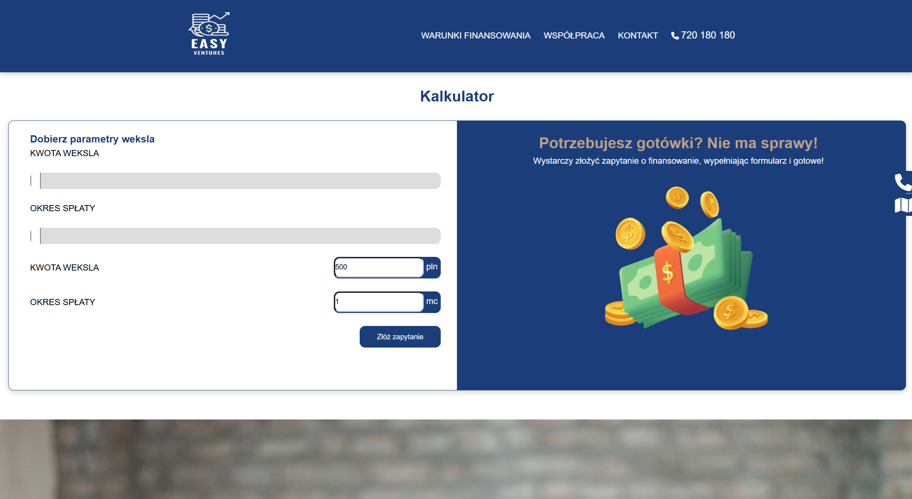
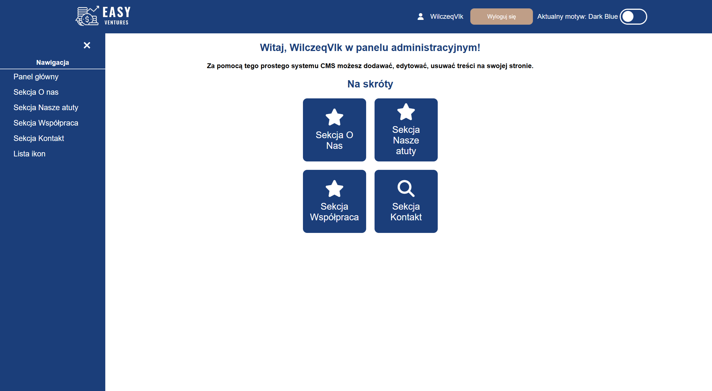
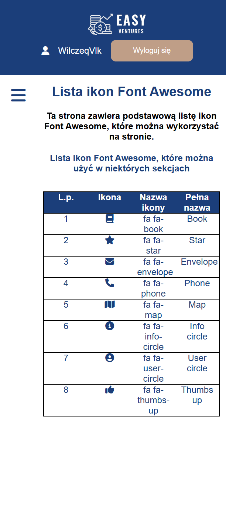

# Easy Ventures - Weksel

Nowoczesna aplikacja webowa dla usług finansowych opartych na wekslach. Projekt umożliwia obliczenie parametrów finansowania, złożenie zapytania oraz zarządzanie treścią strony w prostym panelu administracyjnym.

## Zrzuty ekranu

### Strona glowna i kalkulator



Kalkulator pozwala podać kwotę weksla i okres spłaty. Formularz zapytania zbiera dane klienta i przekazuje je do wysłania pocztą e-mail.

### Panel logowania


Administrator może zalogować się do systemu CMS i zarządzać zawartością serwisu.

### Panel administracyjny



Panel pozwala edytować sekcje: **O nas**, **Nasze atuty**, **Współpraca** i **Kontakt**, a także przeglądać dostępne ikony Font Awesome.

### Widok mobilny



Interfejs dostosowuje się do urządzeń mobilnych, zachowując dostępność formularzy i panelu administracyjnego.

## Funkcjonalności

- kalkulator parametrów weksla,
- formularz złożenia zapytania,
- wysyłanie zapytania pocztą e-mail,
- strony z warunkami finansowania i instrukcjami,
- sekcja współpracy i polityka prywatności,
- logowanie i rejestracja administratorów,
- panel CMS do zarządzania treścią strony,
- zmiana motywu jasnego i ciemnego w panelu,
- responsywne widoki desktopowe i mobilne.

## Technologie

- PHP 8.1+
- Laravel 10
- MySQL / MariaDB
- Bootstrap 5
- Sass
- Vite
- Font Awesome
- PHPUnit

## Wymagania

- PHP 8.1 lub nowszy,
- Composer,
- Node.js i npm,
- MySQL lub MariaDB,
- serwer WWW, np. Apache z XAMPP.

## Instalacja lokalna

1. Sklonuj repozytorium i przejdź do katalogu projektu:

   ```bash
   cd easyventures-weksle
   ```

2. Zainstaluj zależności PHP i JavaScript:

   ```bash
   composer install
   npm install
   ```

3. Utwórz plik konfiguracyjny:

   ```bash
   cp .env.example .env
   ```

   Na Windows w PowerShell można zamiast tego wykonać:

   ```powershell
   Copy-Item .env.example .env
   ```

4. Wygeneruj klucz aplikacji:

   ```bash
   php artisan key:generate
   ```

5. Utwórz bazę danych MySQL i ustaw w `.env` parametry `DB_DATABASE`, `DB_USERNAME` oraz `DB_PASSWORD`.

6. Uruchom migracje:

   ```bash
   php artisan migrate
   ```

7. Skonfiguruj serwer pocztowy. Domyślnie formularz wysyła zapytanie na adres `kontakt@naweksel.pl`; ustaw dane SMTP w zmiennych `MAIL_*` pliku `.env`.

8. Uruchom serwer Vite i aplikację Laravel:

   ```bash
   npm run dev
   ```

   W drugim terminalu:

   ```bash
   php artisan serve
   ```

Aplikacja będzie domyślnie dostępna pod adresem `http://127.0.0.1:8000`.

Przy uruchamianiu aplikacji przez XAMPP umieść projekt w katalogu `htdocs` i wejdź pod adres odpowiadający lokalnej ścieżce projektu.

## Najważniejsze adresy

| Adres | Opis |
| --- | --- |
| `/` | Strona główna i kalkulator |
| `/zloz-zapytanie` | Formularz złożenia zapytania |
| `/warunki-finansowania` | Warunki finansowania |
| `/jak-zlozyc-wniosek` | Instrukcja złożenia wniosku |
| `/jak-splacic-naleznosc` | Instrukcja spłaty |
| `/wspolpraca` | Informacje o współpracy |
| `/polityka-prywatnosci` | Polityka prywatności |
| `/admin/login` | Logowanie do panelu administracyjnego |
| `/admin/dashboard` | Panel zarządzania treścią |

## Budowanie zasobów

Podczas tworzenia uruchom serwer developerski Vite:

```bash
npm run dev
```

Gotową wersję zasobów CSS i JavaScript utworzysz poleceniem:

```bash
npm run build
```

## Testy

Uruchom testy projektu poleceniem:

```bash
php artisan test
```
